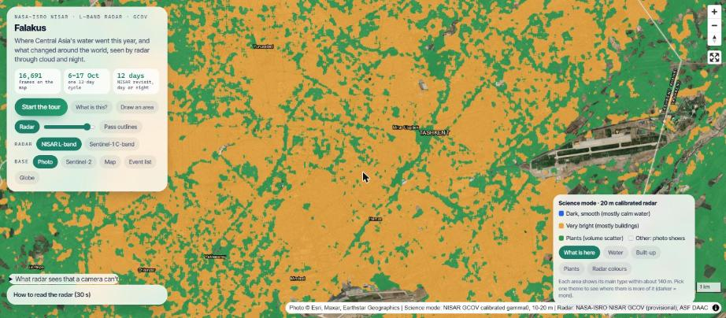
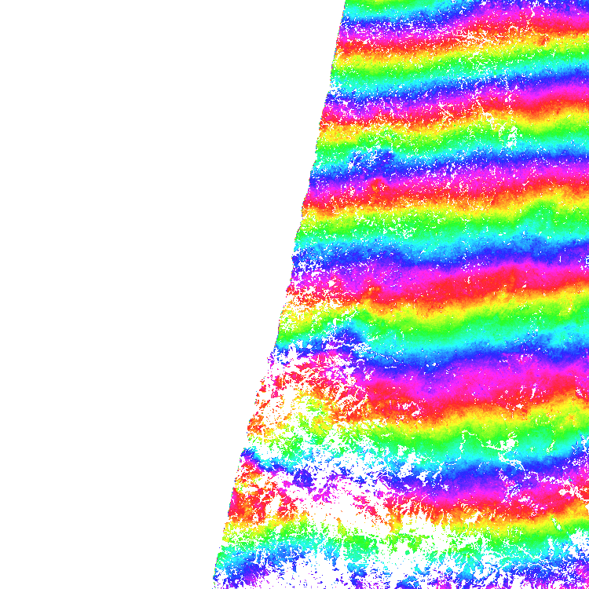
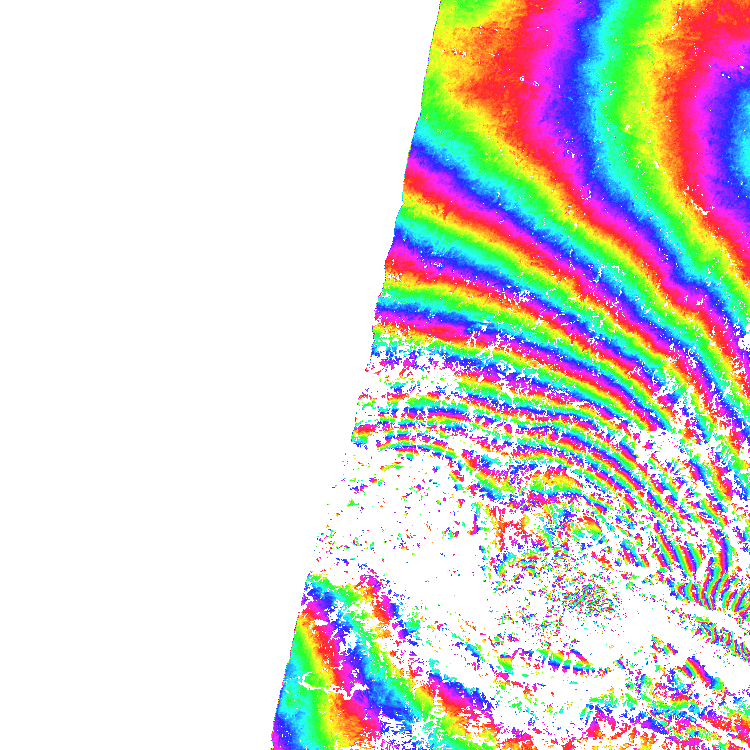
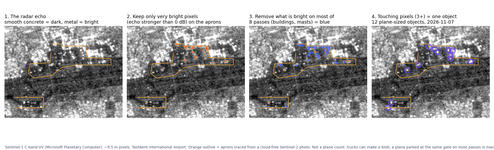
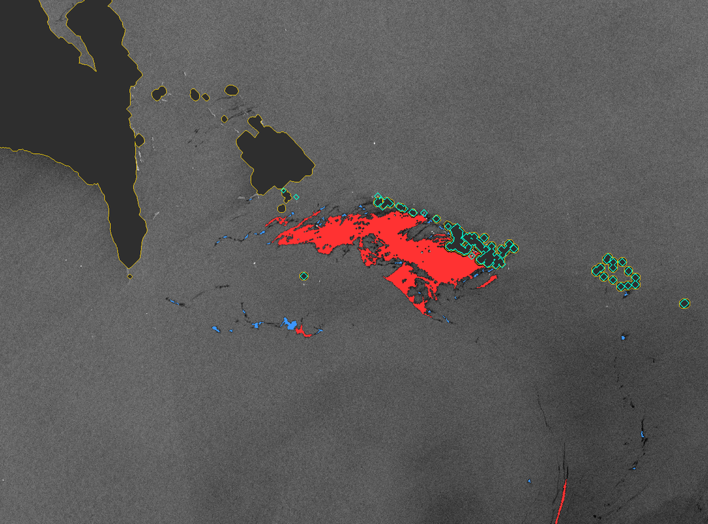
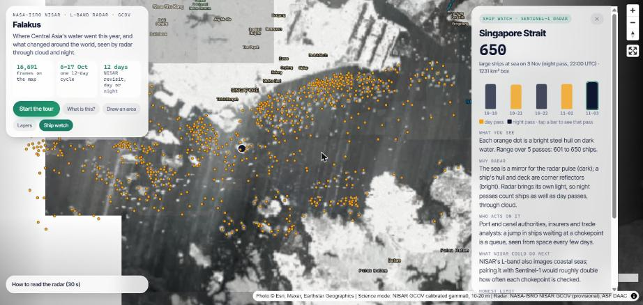
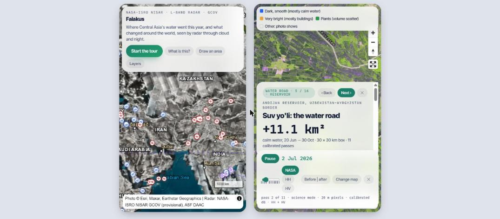

# Falakus

**See how the Earth changes, through cloud and at night, with NASA-ISRO NISAR radar.**

An open, interactive web map built for the NASA Space Apps Challenge 2026, *Dancing with the SARs*.
It starts at home, with Central Asia's water: the Aral Sea, Rogun, the Qosh Tepa canal, the Fergana valley and Kyzylorda rice. Then it goes worldwide: earthquakes, landslides, floods, fires, ships and oil slicks.



---

## 1. The idea in 30 seconds

A normal satellite is a camera, so it needs sunlight and a clear sky.
NISAR is a **flashlight**. It sends its own microwave pulse (L-band, 24 cm wavelength) and listens for the echo. Clouds, smoke and night do not matter.

What comes back tells you what the ground is made of:

| what the pulse hits | what happens | on our map |
|---|---|---|
| calm water | bounces away like a mirror | **dark** |
| a city | wall + street form a corner and send the pulse straight back (double bounce) | **very bright** |
| forest, crops | leaves and stems scatter it in every direction, and some comes back turned sideways (cross-polarized, **HV**) | **bright in HV** |
| wet soil | water raises the dielectric constant, so more echo comes back | **brighter than dry soil** |
| ground that moved | the echo's *phase* shifts; 11.9 cm of motion = one full rainbow band | **rainbow fringes** |

Falakus turns these echoes into numbers (km² of water, % built-up, cm of motion) and plain sentences. For every place it answers: *what changed, by how much, why, and who should care*.

---

## 2. What you can do in the app

| feature | what it shows | data |
|---|---|---|
| **World map** | 16,691 NISAR frames from one 12-day cycle (6–17 Oct 2026) | NISAR GCOV browse |
| **Guided tour** (16 stops, 2 chapters) | the water road of Central Asia, then the world | NISAR GCOV |
| **Time player + before/after swipe + change map** | every pass over a place since the archive began | NISAR GCOV |
| **HH / HV toggle** | surface bounce (water, bare ground) vs volume bounce (trees, crops) | NISAR GCOV |
| **Science mode, 10–20 m** | calibrated dB, each pixel classified as water / built-up / plants | NISAR GCOV HDF5 |
| **"What happened here?"** | click anywhere on land, or draw a box: a full analysis at native resolution | NISAR GCOV HDF5 |
| **Ground motion** | Panama M7.7 earthquake, ~1 m of motion, shown next to a **pre-quake control pair** | NISAR GUNW |
| **Ship watch** | ships at 7 chokepoints (Hormuz, Suez, Malacca, Singapore, Panama, Bosphorus, Gibraltar), day and night | Sentinel-1 |
| **Radar finds** | oil-slick candidates off Baku, plane-sized objects at Tashkent airport | Sentinel-1 |
| **Events** | 1,308 fires, floods, storms, ice events and M5+ earthquakes | NASA EONET, USGS |
| **L-band vs C-band** | switch between NISAR (24 cm) and Sentinel-1 (5.6 cm) | NISAR + Sentinel-1 |
| **ML land cover** | Random Forest on NISAR time series, tested against ESA WorldCover | NISAR + ESA |

---

## 3. How it works, with pictures

### 3.1 Ground motion: the interferogram (NISAR GUNW)

NISAR measures the **phase** of its 23.8 cm wave. Image the same ground twice: if the ground moved toward the satellite, the round trip got shorter and the phase shifted. Half a wavelength of motion (11.9 cm) gives one full colour band.

| before the quake (control: 20 Sep → 2 Oct) | across the quake (2 → 14 Oct, M7.7 on 9 Oct) |
|---|---|
|  |  |
| straight, evenly spaced bands = a smooth tilt from the ionosphere and orbit. **Not ground motion.** | curved bands that bunch toward the epicentre = **the fault slipped**, ~1 m along the line of sight |

The control pair is how we know the quake signal is real. Same orbit track, same 12-day gap: the only new thing is the earthquake.

### 3.2 Finding plane-sized objects at an airport

Nothing is placed by hand. Four steps, all in [`tools/apron_count.py`](tools/apron_count.py):



1. **The echo.** Smooth concrete is dark. A parked aircraft is a metal body whose wing–fuselage corners send the pulse straight back, so it is bright.
2. **Very bright only.** Keep pixels with an echo above 0 dB, but only inside the apron outlines (traced from a cloud-free Sentinel-2 photo).
3. **Remove what never moves.** Terminals, hangars and light masts are bright on *most* of the 8 passes (blue). A plane comes and goes.
4. **Group.** Touching pixels (at least 3, ~270 m²) form one object.

A dot often sits at the **corner** of a plane rather than its centre. A 10 m radar pixel lights up brightest where the wing meets the body. We say "plane-sized objects", not "planes": a cluster of trucks can also make a blob.

### 3.3 Oil-slick candidates (Caspian Sea, Baku)

Wind ripples scatter the pulse back, so the sea looks grey. Oil damps the ripples, so a slick looks **darker than the sea around it**, day or night.
[`tools/slick_find.py`](tools/slick_find.py) keeps patches that are more than 6 dB darker than the local sea, longer than 1 km and elongated (length/width > 3), and masks the 42 fixed oil platforms.



The detector is labelled **candidates**. Low wind, rain cells and natural films make look-alikes. Passes with very calm or very rough sea are flagged.

### 3.4 Ships at chokepoints



A steel hull is a bright point on dark water. [`tools/ship_count.py`](tools/ship_count.py) is a CFAR-style detector:
- a pixel brighter than 0.25 that sits in a dark neighbourhood (< 0.03) is a candidate;
- a 250 m shore band is excluded, so coasts and quays are not counted;
- blobs of at least 3 px count as one ship.

Passes where wind turned the sea bright are greyed out instead of trusted.

---

## 4. Science you can check

| claim | how we checked it | result |
|---|---|---|
| built-up share of Tashkent (30 × 30 km) | our dB rule vs the known urban footprint | 35.8 % measured vs ~37 % |
| Aral Sea, eastern basin | water share over 10 passes | 0.03–0.93 km² of 1,600 km² is water: ~84 % bare seabed |
| land cover by machine learning | train on 4 places, test on a 5th the model never saw, against ESA WorldCover 10 m | ML beats fixed rules: Fergana **66 % vs 36 %**, Tashkent **60 % vs 48 %**, Andijan **58 % vs 26 %** |
| known ML failure | Aral is 98 % bare seabed, and the training places had almost none | 0 % accuracy there: *a model only knows what it was shown*. Fix: train on more desert places |
| quake signal is real | co-event pair vs control pair, same track | curved bunched fringes only in the quake pair |

Fixed physical rules (in [`tools/sar_colors.py`](tools/sar_colors.py)):
- **water** = HH < −18 dB and HV < −24 dB
- **very bright (built-up)** = HH > −5 dB
- **plants** = HV > −17 dB

**Honest limits:**
- Most NISAR data is still *provisional* (public beta); validated products start 21 Oct 2026.
- There is a permanent NISAR data gap from 27 Jul to 10 Aug 2026.
- Wind makes calm water look like land, so for water we report the calm-day maximum.
- Over dry ground, HV shows the noise floor, not plants.

---

## 5. Run it yourself

```bash
pip install earthaccess h5py numpy scipy pillow scikit-learn matplotlib
python tools/nisar_tile_server.py --port 8765      # then open http://127.0.0.1:8765
```

The world map and the tour work without any login.
Science mode reads calibrated NISAR files, so it needs a free [NASA Earthdata Login](https://urs.earthdata.nasa.gov). Run `earthaccess.login(persist=True)` once in Python to store it.

Rebuild a science area:

```bash
python tools/gcov_science.py aral 60.0 45.3 --km 20     # read calibrated HH/HV for every pass (box reads, no 2 GB downloads)
python tools/science_render.py aral 60.0 45.3 --km 20   # images per pass
python tools/science_pyramid.py aral                    # web map tiles z10-14
python tools/ml_landcover.py                            # ML land cover vs ESA WorldCover (leave-one-place-out)
python tools/gunw_read.py panama_m77 -80.7566 7.6069 20261002 20261014 --km 30   # ground motion
```

### Code map

| file | job |
|---|---|
| `tools/nisar_tile_server.py` | local server: world tiles, time series, science tiles, jobs, events |
| `tools/nisar_index.py`, `fetch_previews.py` | find every NISAR frame in NASA CMR, fetch browse previews |
| `tools/gcov_science.py` | read a box of calibrated HH/HV from each GCOV HDF5 file |
| `tools/science_render.py`, `science_pyramid.py` | turn dB into images and Web Mercator tiles |
| `tools/sar_colors.py` | one colour law and one class rule for every place |
| `tools/analyze_area.py` | "What happened here?" for any box |
| `tools/gunw_read.py` | interferogram to fringes and centimetres |
| `tools/ship_count.py`, `slick_find.py`, `apron_count.py` | Sentinel-1 detectors |
| `tools/ml_landcover.py` | Random Forest land cover, scored on unseen places |
| `tools/utm_convert.py` | UTM ↔ lon/lat (vectorised) |
| `web/index.html`, `web/stops.js` | the app (MapLibre GL) and the tour stories |



---

## 6. Data sources

- **NISAR L2 GCOV and GUNW** (NASA-ISRO), ASF DAAC via NASA CMR and Earthdata Cloud
- **NASA EONET** natural events
- **USGS** earthquake catalogue (M5+)
- **Sentinel-1 RTC** and **ESA WorldCover 2021**, via Microsoft Planetary Computer
- **Sentinel-2** cloudless (EOX) and Esri World Imagery for optical context

## 7. AI use (as the challenge rules require)

- The code, the detectors and the text were written with help from an AI coding assistant (Anthropic Claude). The team reviewed and tested the results.
- Every number in the app is computed by the scripts in this repo from the data above.
- No AI-generated images are used. No NASA logos appear in generated content.

## 8. Team

Team of 4 from Tashkent, Uzbekistan. NASA Space Apps Challenge 2026.

## License

MIT, see [LICENSE](LICENSE).
